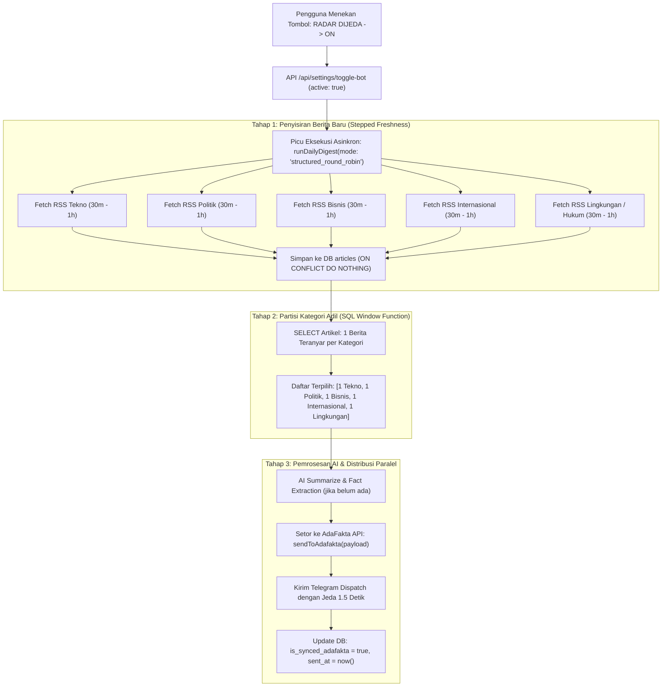

# Rencana Implementasi: Distribusi Setoran Terstruktur per Kategori (Opsi 1)

> **Dokumen Rencana Teknis & Arsitektur Sistem**  
> **Status:** Siap Ditinjau (Menunggu Persetujuan Redaktur Sebelum Implementasi)  
> **Target:** Penyetoran Terstruktur & Berimbang ke Meja Redaksi AdaFakta & Telegram saat Radar Aktif (ON)

---

## 1. Latar Belakang & Analisis Masalah

### Kondisi Saat Ini (Sebelum Perubahan)
Saat bot radar diaktifkan (**ON**) atau saat cron berjalan, fungsi pemrosesan antrean di `lib/pipeline.ts` menggunakan kueri:
```sql
SELECT id, source, title, url, published_at, summary, sent_at, created_at, category, is_priority
FROM articles
WHERE sent_at IS NULL
ORDER BY is_priority DESC, published_at DESC NULLS LAST
LIMIT 3;
```
**Kelemahan Fatal:**
1. **Monopoli Isu Tunggal (*Greedy Pick*)**: Jika salah satu portal media (misal Detik atau Kompas) baru saja mempublikasikan 5 berita politik secara beruntun, maka ketiga kuota setoran diborong oleh berita Politik. Kategori **Teknologi & AI, Internasional, Bisnis, Lingkungan, dan Hukum** menjadi kosong.
2. **Meja Redaksi AdaFakta Tidak Berimbang**: Redaktur di `adafakta.web.id` menerima draft yang hanya menumpuk di satu tab rubrik, sementara rubrik lain tidak mendapatkan suplai berita investigasi harian.
3. **Pemberitahuan Telegram Monoton**: Redaktur menerima rentetan notifikasi Telegram yang topiknya sama secara berturut-turut.
4. **Keterlambatan Eksekusi Saat Tombol Ditekan**: Menekan tombol dari OFF ke ON saat ini hanya mengubah nilai variabel di database tanpa langsung memicu penelusuran perdana (*initial scout dispatch*).

---

## 2. Solusi: Distribusi Terstruktur & Berimbang (Opsi 1)

Sistem akan menerapkan **Fair Category Distribution** dengan mekanisme berikut:
1. **Penyisiran Serentak Menggunakan Stepped Freshness**: Mengambil berita paling baru (30m $\rightarrow$ 1h $\rightarrow$ 2h) dari setiap kategori feed aktif.
2. **Kueri Window Function Postgres (Partition by Category)**: Mengambil **tepat 1 (atau maksimal 2) berita PALING BARU dari masing-masing kategori** yang belum pernah disetor.
3. **Penyetoran Terstruktur ke AdaFakta**: Setiap artikel disetor dengan atribut `category` yang tepat sehingga langsung terdistribusi ke tab rubrik yang sesuai di Meja Redaksi.
4. **Pengiriman Telegram Bertahap (*Paced Dispatch*)**: Notifikasi Telegram dikirim dengan jeda waktu aman (1.5 detik) antar-rubrik untuk menghindari pembatasan limit (Rate Limit 429) dan memberikan tampilan feed yang rapi di layar ponsel redaktur.
5. **Pemicuan Instan Saat Saklar Ditekan ON**: Saat tombol berubah status menjadi `RADAR AKTIF 24/7 (ON)`, sistem langsung mengeksekusi siklus perdana di latar belakang (*background job*).

---

## 3. Diagram Alur Kerja (Workflow)



---

## 4. Rincian Teknis Perubahan

### A. Kueri Antrean Adil di `lib/pipeline.ts`
Mengganti seleksi `LIMIT 3` polos dengan kueri berpartisi:
```sql
WITH ranked_articles AS (
  SELECT id, source, title, url, published_at, summary, sent_at, created_at, category, is_priority,
         ROW_NUMBER() OVER (
           PARTITION BY COALESCE(category, 'UMUM')
           ORDER BY is_priority DESC, published_at DESC NULLS LAST
         ) as rank_in_cat
  FROM articles
  WHERE sent_at IS NULL AND is_synced_adafakta = false
)
SELECT id, source, title, url, published_at, summary, sent_at, created_at, category, is_priority
FROM ranked_articles
WHERE rank_in_cat <= 1
ORDER BY is_priority DESC, published_at DESC NULLS LAST
LIMIT 6;
```
*Hasil Kueri:* Menghasilkan maksimal 6 artikel teratas, di mana **masing-masing artikel berasal dari kategori yang berbeda**, diurutkan dari yang paling baru diterbitkan (*published_at DESC*).

---

### B. Otomatisasi Instan pada Saklar Bot (`app/api/settings/toggle-bot/route.ts`)
Saat status diubah menjadi `active: true`:
1. Simpan pengaturan status aktif ke database/pengaturan.
2. Segera jalankan `runDailyDigest()` di latar belakang tanpa memblokir respon HTTP:
```typescript
if (targetState === true) {
  // Jalankan penyisiran perdana secara asinkron di latar belakang
  (async () => {
    try {
      await runDailyDigest();
    } catch (e) {
      console.error("[Auto-Run ON] Gagal menjalankan digest perdana:", e);
    }
  })();
}
```
*Hasil:* Pengguna tidak perlu menunggu jadwal cron jam berikutnya. Sekali tombol diklik menjadi hijau (ON), sistem langsung bekerja dan mengirimkan setoran berita terbaru.

---

### C. Jeda Waktu Pengiriman Telegram (*Rate-Limit Safe*)
Agar pengiriman 5-6 artikel dari rubrik yang berbeda tidak dianggap spam oleh server Telegram:
```typescript
// Beri jeda 1.5 detik antar-pesan ke Telegram
await new Promise((resolve) => setTimeout(resolve, 1500));
await sendTelegram(message, buttons, undefined, DEFAULT_PERSISTENT_KEYBOARD);
```

---

### D. Jaminan Integritas Backend AdaFakta (`adafakta.web.id`)
- Tidak ada struktur tabel atau API contract yang diubah.
- Fungsi [`sendToAdafakta`](file:///e:/porto/bottele/berita-ai/lib/adafakta.ts) tetap menerima format standar:
  ```json
  {
    "title": "Judul Berita",
    "source": "Tempo / Antara / Detik",
    "url": "https://...",
    "published_at": "2026-11-03T12:00:00Z",
    "summary": "Ringkasan AI 3 Paragraf",
    "category": "TEKNO" 
  }
  ```
- Dengan atribut `category` yang tepat, sistem AdaFakta langsung mengelompokkan draft berita tersebut ke rubriknya masing-masing.

---

## 5. Ringkasan File yang Akan Dimodifikasi

| Berkas | Peran Perubahan |
| :--- | :--- |
| `lib/pipeline.ts` | Mengimplementasikan window query `PARTITION BY category` dan jeda pengiriman Telegram |
| `app/api/settings/toggle-bot/route.ts` | Memicu eksekusi penyisiran otomatis instan saat bot diaktifkan ke status `active: true` |
| `app/CommandCenterView.tsx` | Memperbarui pesan respon saat bot diaktifkan ("Radar Aktif: Mulai menyisir dan menyetor berita terbaru per rubrik...") |

---

## 6. Pertanyaan / Validasi Sebelum Implementasi
1. Apakah kuota **1 berita paling baru per rubrik** (total sekitar 5-6 artikel sekali jalan: 1 Tekno, 1 Politik, 1 Bisnis, 1 Internasional, 1 Lingkungan, 1 Hukum) sudah ideal untuk meja redaksi Anda?
2. Apakah jeda waktu 1.5 detik antar-notifikasi Telegram sudah sesuai dengan kenyamanan Anda?

> [!NOTE]
> Sesuai instruksi Anda, **belum ada perubahan kode yang dilakukan**. Setelah Anda menyetujui rencana di atas, proses implementasi akan segera dijalankan.

